<p align="center"></p>

<h1 align="center">Agency</h1>

<p align="center">
  <strong>Describe an app in plain words. Agency builds it on your organization's data and runs it for your team.</strong>
</p>

<p align="center">
  <a href="#quick-start">Quick start</a> ·
  <a href="docs/architecture.md">How it works</a> ·
  <a href="docs/deploy.md">Deploy</a> ·
  <a href="docs/connections.md">Connections</a> ·
  <a href="docs/skills.md">Skills</a> ·
  <a href="docs/admin.md">Admin guide</a> ·
  <a href="docs/security.md">Security</a> ·
  <a href="PLAN.md">Roadmap</a> ·
  <a href="LICENSE">MIT license</a>
</p>

<p align="center">
  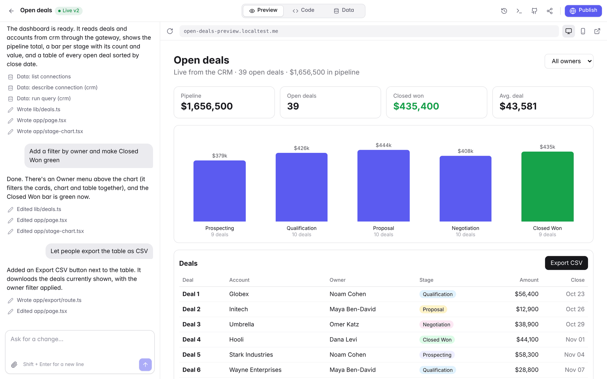
</p>

<p align="center">
  <sub><em>"A dashboard of open deals from our CRM, grouped by stage with totals." Three messages later it is live for the sales team.</em></sub>
</p>

---

## What is Agency?

Agency is a self-hosted, open source (MIT) app builder for the people inside one organization, in the spirit of Lovable and Base44, but running on your own server and wired to your own data.

Someone types what they need. The [pi](https://github.com/earendil-works/pi) coding agent builds it as a Next.js app in a sandbox container, the live preview updates beside the chat, and one click publishes it to `https://<app>.<your-domain>` for the rest of the team. Apps read the organization's data (Postgres, Supabase, Google Drive, Salesforce, monday.com, any MCP server) through a gateway, so credentials never end up in generated code.

Everything runs on one machine you control: a single AWS instance with Docker, set up by one script.

---

## Stuff you do in Agency

- **Turn a request into a working internal tool.** "A form where the team logs expenses, with a monthly summary chart" becomes a real app with its own database, not a mockup.
- **Build on live company data without handing out keys.** An admin connects the CRM or the shared drive once; the agent reads schemas and samples while it builds, and published apps query through the gateway with their own token.
- **Keep iterating like a conversation.** Ask for a filter, a new column, an export button. Every agent turn is a version you can restore, and you can attach screenshots, mockups or CSV files to a message.
- **Open the hood when you want to.** Edit the code in the browser, browse and edit the app's tables, run SQL, or push the whole history to your GitHub organization.
- **Share it with exactly the right people.** Apps sit behind the team's sign-in (SSO if you want it), and each app's owner decides who can view and who can edit.
- **Plan first, or just talk it through.** Pick Auto to build right away, Plan to get a plan you approve before any code changes, or Chat to discuss without touching files, and choose which Claude model answers.
- **Teach the agent how your company builds.** Add skills for your design system, your data model or your house rules, for yourself or for the whole organization.
- **Keep AI spend in check.** Every message is priced and charged to whoever sent it, against a monthly budget an admin sets per person.

---

## A look inside

<table>
  <tr>
    <td width="50%" valign="top">
      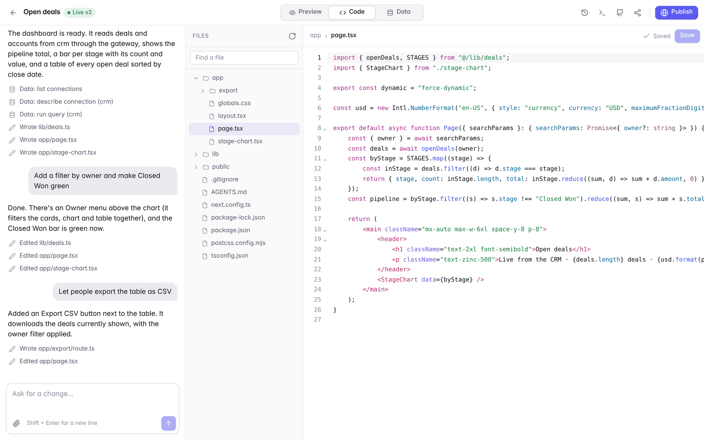<br>
      <sub><strong>Real code, yours to edit.</strong> A Next.js project with a file tree and an editor; a save is a new version.</sub>
    </td>
    <td width="50%" valign="top">
      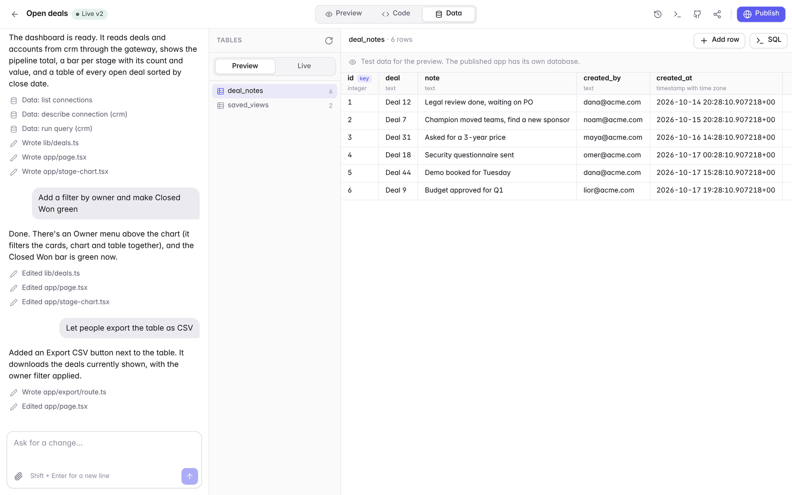<br>
      <sub><strong>Every app gets a database.</strong> Separate preview and live data, editable in place or with SQL.</sub>
    </td>
  </tr>
  <tr>
    <td width="50%" valign="top">
      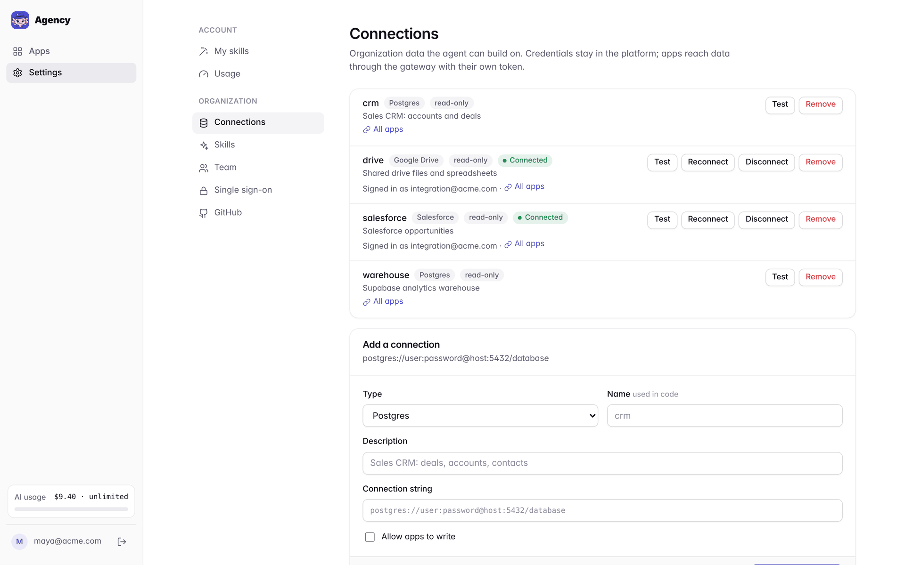<br>
      <sub><strong>Connect once, build many times.</strong> Databases, built-in OAuth connectors and any MCP server.</sub>
    </td>
    <td width="50%" valign="top">
      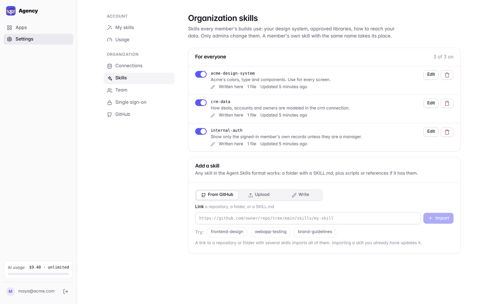<br>
      <sub><strong>Skills for the agent.</strong> Import from GitHub, upload a SKILL.md, or write one in the browser.</sub>
    </td>
  </tr>
  <tr>
    <td width="50%" valign="top">
      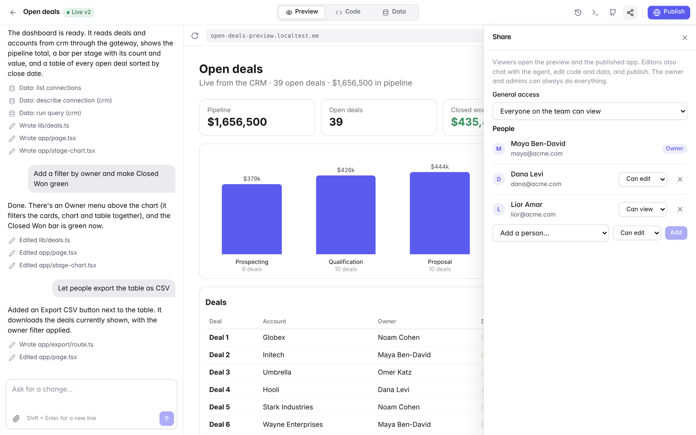<br>
      <sub><strong>Per-app sharing.</strong> Team-wide view or edit, plus individual people.</sub>
    </td>
    <td width="50%" valign="top">
      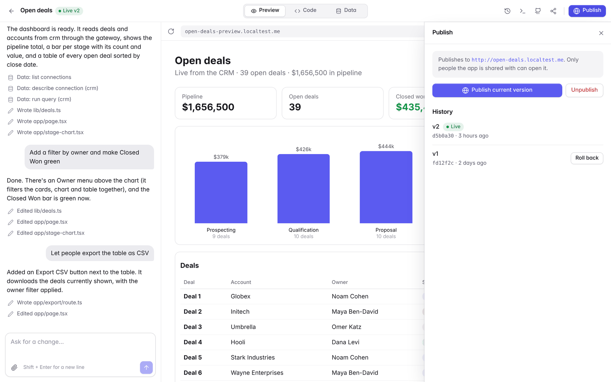<br>
      <sub><strong>Publish and roll back.</strong> Each publish is a versioned image on its own subdomain.</sub>
    </td>
  </tr>
  <tr>
    <td width="50%" valign="top">
      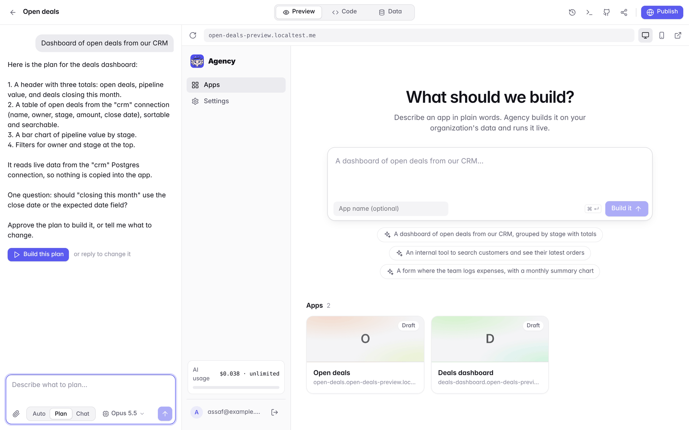<br>
      <sub><strong>Plan before it builds.</strong> Auto, Plan and Chat modes, and a model picker in the composer.</sub>
    </td>
    <td width="50%" valign="top">
      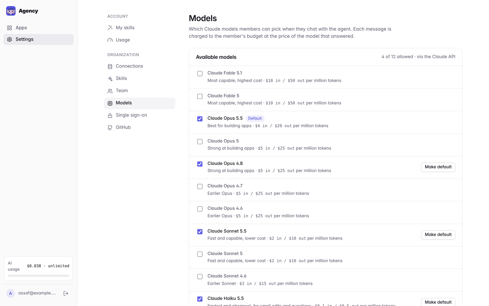<br>
      <sub><strong>Choose the models.</strong> Admins pick which Claude models members may use and the default.</sub>
    </td>
  </tr>
  <tr>
    <td colspan="2" valign="top">
      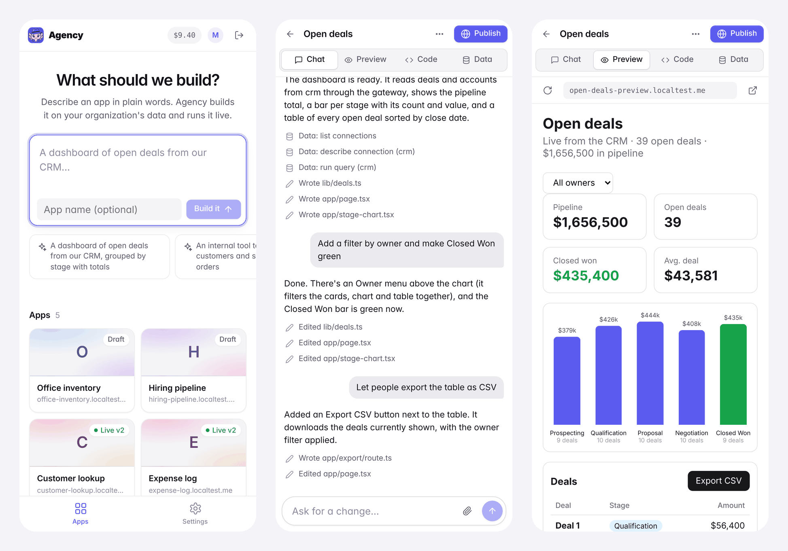<br>
      <sub><strong>Works on a phone.</strong> Ask for a change from anywhere and check the result in the preview tab.</sub>
    </td>
  </tr>
</table>

<details>
<summary>More screenshots: dark mode, versions, team budgets, home</summary>
<br>
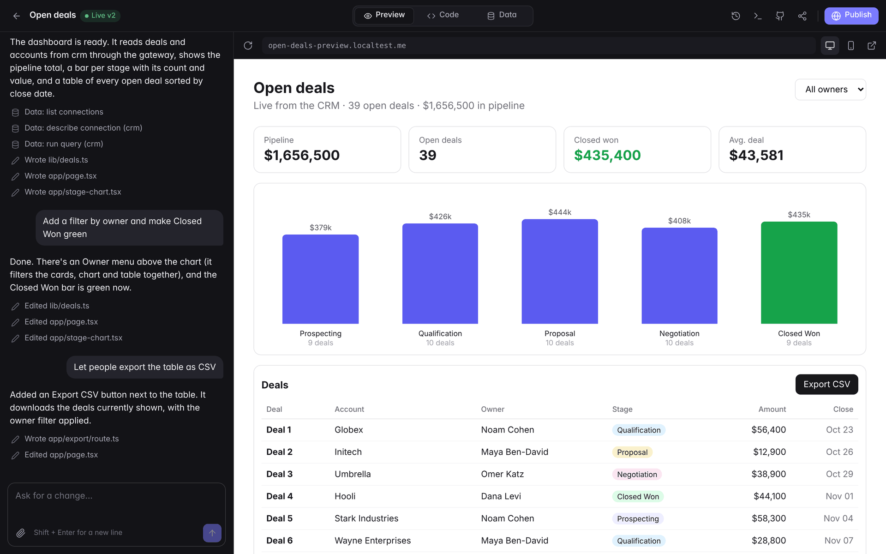
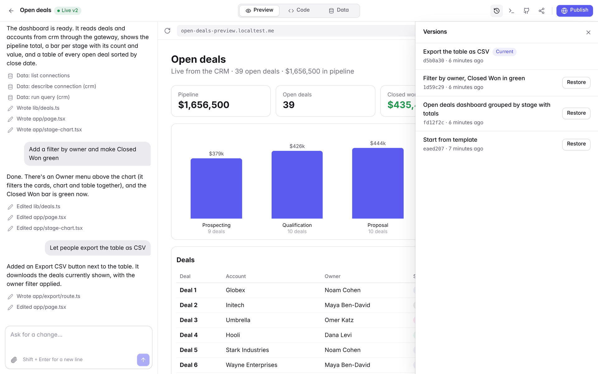
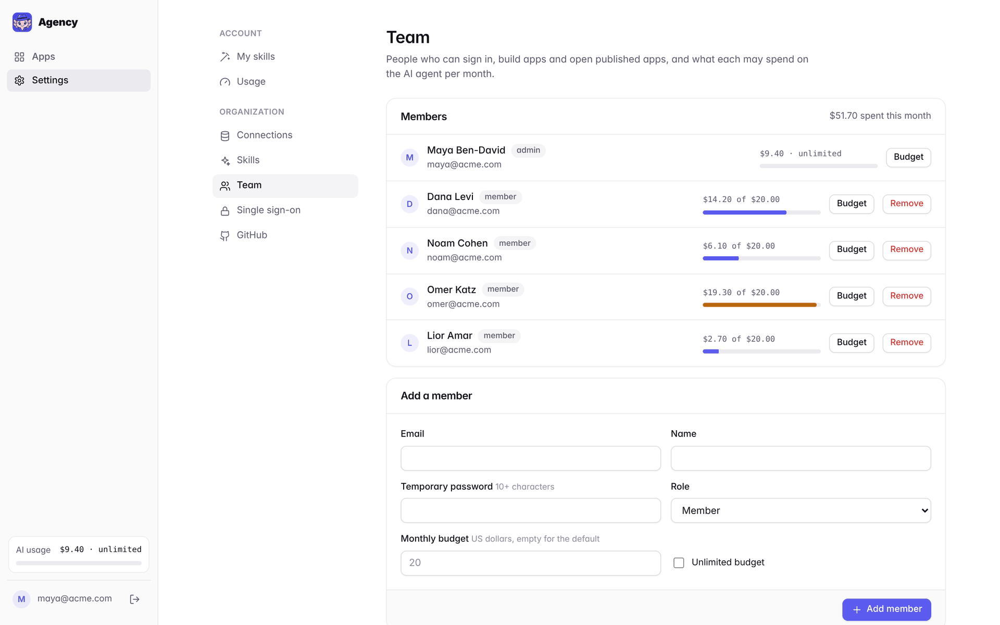
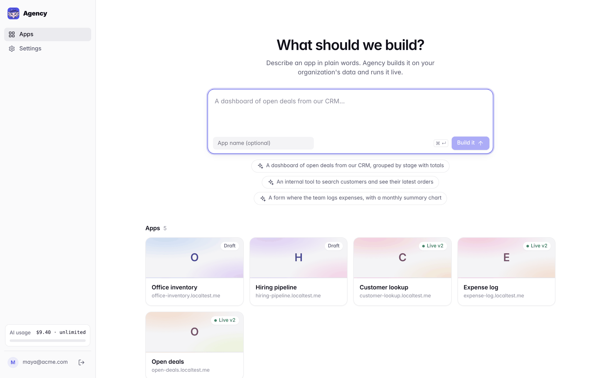
</details>

---

## Features

| Build | Data | Ship | Team and admin |
|---|---|---|---|
| Chat with the pi coding agent, live preview beside it | Postgres, Supabase and AWS RDS connections | One-click publish to `<app>.<your-domain>` | Email and password, or SSO over OpenID Connect (Google Workspace, Entra ID, Okta) |
| Attach images and files to a message | Google Drive and Sheets, Salesforce (built in, OAuth) | Versioned images with rollback | Per-app sharing: owner, editors, viewers |
| Every turn is a restorable version | monday.com, Notion, Linear and any MCP server | Separate live database from the first publish | Monthly AI budgets per member, usage page |
| Code tab with an in-browser editor | Read-only by default; connections can be limited to specific apps | Push to your GitHub organization, automatically for new apps | Personal and organization skills |
| Auto, Plan and Chat modes, with a model picker | Each app gets its own Postgres database, with a Data tab | Nightly backups to S3 | Allowed Claude models and the organization default |
| Phone layout, light and dark | | | One AWS server, or a server plus AWS Fargate; idle apps sleep |

What's next is in the [roadmap](PLAN.md): per-person connector sign-in, sandbox hardening (gVisor or Firecracker, egress allowlist), and packing published apps onto shared EC2 instances as a cheaper alternative to Fargate.

---

## Quick start

### Run it for your team on AWS

You need an AWS account with the AWS CLI signed in, Terraform 1.6+, and a domain.

```bash
git clone https://github.com/assafneudorfer/agency.git
cd agency/infra/aws
./deploy.sh
```

The script asks how to set things up, shows the Terraform plan, and waits until the site answers:

| Setup | DNS | Claude | What you paste |
|---|---|---|---|
| **Cloudflare + Claude API key** | Cloudflare | Anthropic API | A Cloudflare token (Zone > DNS > Edit) and an Anthropic key |
| **All on AWS** | Route 53 | Amazon Bedrock | Nothing: the server's IAM roles do it |

It also asks for a profile, sized by how your organization will use Agency rather than by head count:

| Profile | Runs on | Fits | About a month |
|---|---|---|---|
| **Try it out** | One small server | ~2 apps built at once, a few light published apps | $37 ($7 stopped) |
| **Team** | One larger server | ~4 apps built at once, a dozen published apps | $133 |
| **Organization** | Small server + AWS Fargate | Any number of apps built at once; published apps that scale | $37 + 2 to 6¢ an hour per app being built + $13 per published app |

On the Organization profile each app's dev environment runs only while someone builds it and sleeps when idle, and each published app is its own service that scales with traffic. `./deploy.sh costs` prints what your setup costs, and `./deploy.sh profile` changes it later. Then sign in at `https://<your-domain>` with the admin email and password you chose. The [deploy guide](docs/deploy.md) covers the profiles, the setups, updates, backups and restore.

**Let an agent set it up.** Open the repository in Claude Code (or another coding agent) and ask it to deploy Agency for your organization. [AGENTS.md](AGENTS.md) tells it what to ask, which profile fits, what it will cost, and how to run `deploy.sh` with you.

```bash
./deploy.sh update     # redeploy the latest code
./deploy.sh costs      # what the current setup costs a month
./deploy.sh profile    # change the profile
./deploy.sh stop       # stop the server when nobody is using it (start, status)
./deploy.sh backup     # back up every database now
./deploy.sh destroy    # remove everything
```

### Try it on your laptop

`localtest.me` and all its subdomains resolve to 127.0.0.1, so the whole flow works locally over plain HTTP with Docker:

```bash
cp .env.example .env   # set AGENCY_BASE_DOMAIN=localtest.me, secrets and an LLM key
docker compose --profile build build sandbox
docker compose -f docker-compose.yml -f docker-compose.local.yml up -d --build
open http://localtest.me
```

### First steps after signing in

1. **Settings > Connections**: add your first data source, for example a read-only Postgres role on your CRM ([guide](docs/connections.md)).
2. **Settings > Models**: choose which Claude models members may use and the default.
3. **Settings > Team**: add members and their monthly budgets, or connect **Single sign-on** ([admin guide](docs/admin.md)).
4. **Apps**: describe what you want to build.

---

## How it works

```
          Cloudflare or Route 53 DNS: agency.example.com and *.agency.example.com -> EC2
                                          |
                                     Traefik (TLS, wildcard cert via a DNS challenge)
            ______________________________|______________________________________
           |                              |                                      |
   agency.example.com            crm-preview.agency.example.com         crm.agency.example.com
   platform (UI + API)           sandbox container per app              published app container
     |  docker exec pi --mode rpc   - Next.js dev server :3000            - production build :3000
     |------------------------->    - pi coding agent edits /workspace    - versioned image per publish
     |
     |  /mcp     <- pi inside the sandbox reads schemas and samples data
     |  /gateway <- apps query data with their project token
     |
   Postgres: platform state + one database per app
   Connections: org databases and MCP servers (credentials encrypted, only the platform holds them)
```

- **Platform** (`platform/`): Node 22 and Hono, TypeScript run directly by Node, and a Preact + htm UI with no build step. It manages people, apps, connections and deployments, and drives Docker.
- **Sandbox** (`sandbox/`): one container per app with a Next.js template and pi from npm (pinned by `PI_VERSION`). The platform runs `pi --mode rpc` inside it and streams its events to the browser. Apps nobody is using go to sleep and wake when opened.
- **Gateway**: the only way apps and the agent reach organization data. It holds the credentials and checks which apps may use each connection.
- **Traefik**: TLS and routing for the platform, every preview and every published app, with a sign-in check in front of all of them.

The full walkthrough is in [docs/architecture.md](docs/architecture.md).

---

## Repository layout

```
platform/        the Agency server and web UI (Hono, Preact)
sandbox/         the sandbox image: Next.js app template, pi, the agent's system prompt
infra/aws/       Terraform and deploy.sh for the one-instance AWS setup
docs/            guides, brand assets and screenshots
docker-compose*.yml   the stack, plus overrides for local, Route 53 and Bedrock
PLAN.md          roadmap
```

## Configuration

`deploy.sh` writes the server's `.env` for you. For a hand-made setup, copy [`.env.example`](.env.example):

| Variable | What it is |
|---|---|
| `AGENCY_BASE_DOMAIN` | Domain of the platform; apps get `<name>.<domain>`, previews `<name>-preview.<domain>` |
| `ACME_EMAIL` | Email for Let's Encrypt |
| `CLOUDFLARE_DNS_API_TOKEN` | Cloudflare token for the wildcard certificate (Cloudflare setup) |
| `AGENCY_SECRET_KEY`, `POSTGRES_PASSWORD` | Encryption key for stored credentials, and the database password (`openssl rand -base64 32`) |
| `AGENCY_ADMIN_EMAIL`, `AGENCY_ADMIN_PASSWORD` | The first admin, created when there are no users |
| `ANTHROPIC_API_KEY`, `OPENAI_API_KEY`, `AGENCY_MODEL` | LLM keys for the coding agent and an optional pi model pattern |
| `AGENCY_DEFAULT_BUDGET_USD` | Monthly AI budget for new members (20 by default) |

## Documentation

| Guide | What's in it |
|---|---|
| [How it works](docs/architecture.md) | Platform, sandboxes, publishing, app databases, user headers, usage |
| [Deploy](docs/deploy.md) | Both AWS setups, moving between them, commands, backups and restore, costs, running locally |
| [Connections](docs/connections.md) | Every data source type, OAuth sign-in, read-only and per-app access |
| [Skills](docs/skills.md) | Personal and organization skills, importing from GitHub, how pi loads them |
| [Admin guide](docs/admin.md) | Settings, models and chat modes, sharing apps, budgets, single sign-on, GitHub |
| [Security](docs/security.md) | What to know before you put it in front of your team |
| [Brand](docs/brand/README.md) | Axel the axolotl, and where the logo is used |

## Contributing

Issues and pull requests are welcome. The platform runs TypeScript directly, so there is nothing to build; check types before sending a change:

```bash
cd platform
npm ci
npm run typecheck
```

## Built with

[pi](https://github.com/earendil-works/pi) (the coding agent), [Hono](https://hono.dev), [Preact](https://preactjs.com) and [htm](https://github.com/developit/htm), [CodeMirror](https://codemirror.net), [Next.js](https://nextjs.org), [Traefik](https://traefik.io), [PostgreSQL](https://www.postgresql.org), the [Model Context Protocol](https://modelcontextprotocol.io) and [Agent Skills](https://agentskills.io). Axel, the mascot, was drawn with Higgsfield.

## License

Agency is released under the [MIT license](LICENSE).
